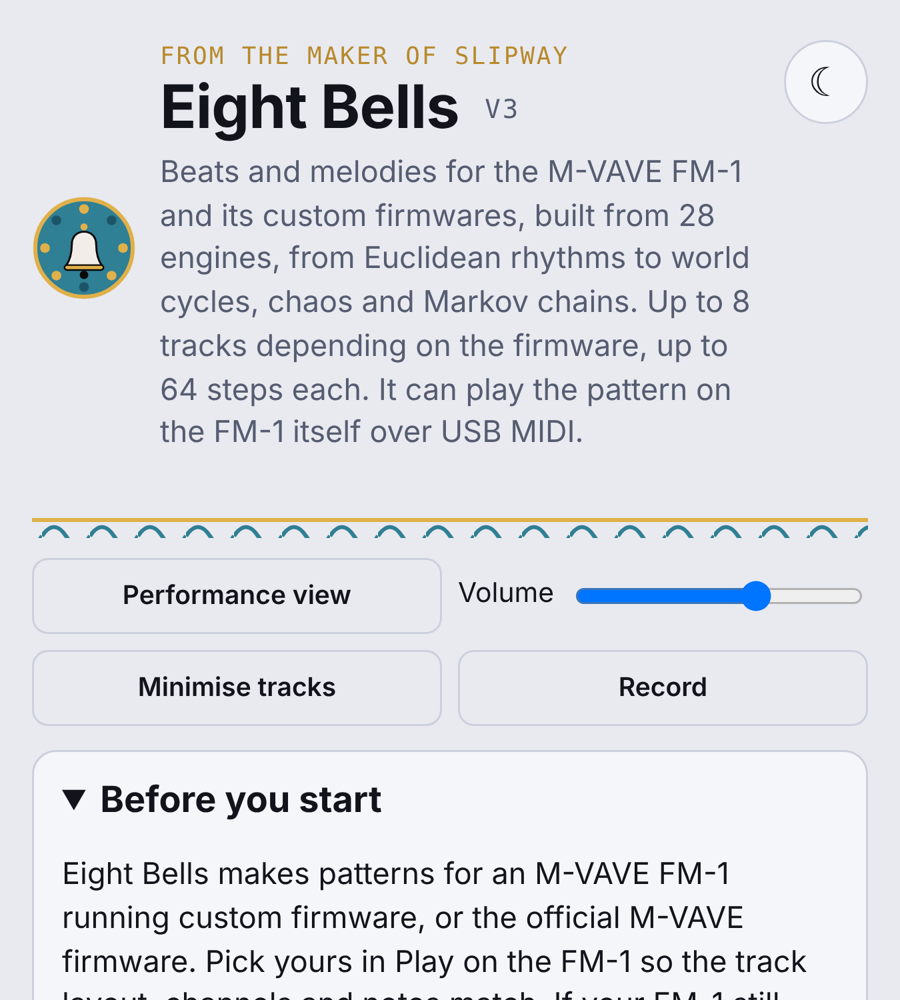
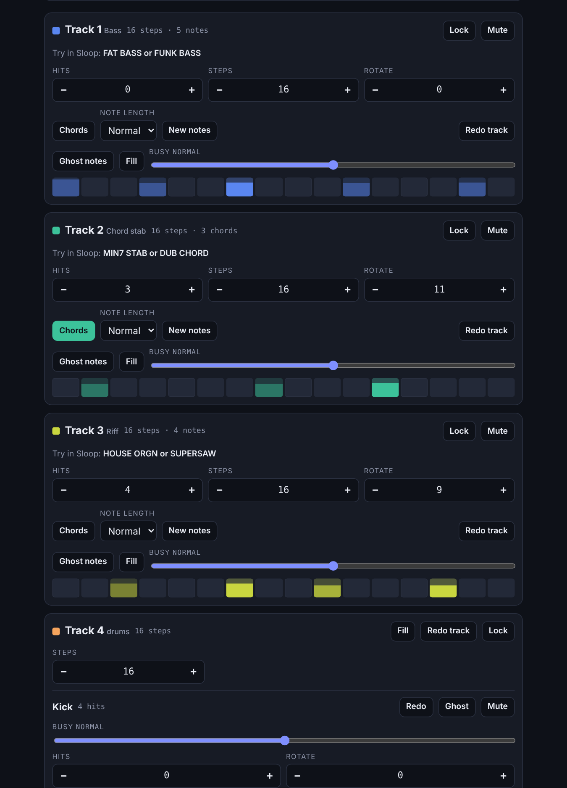
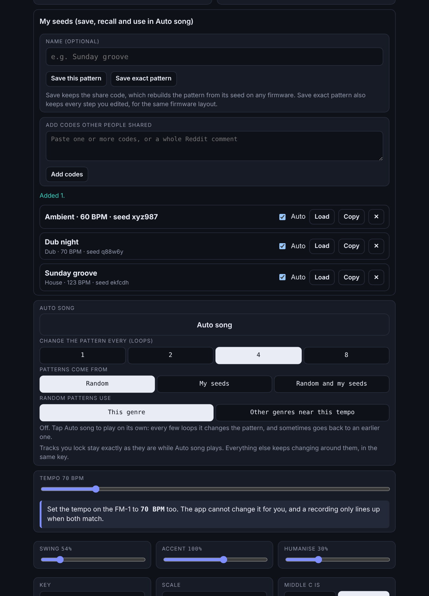

<p align="center"></p>

# Eight Bells

Beats and melodies for the **M-VAVE FM-1** and its custom firmwares, built from 28 engines: Euclidean, world cycles, cellular automata, fractals, number patterns, mirror, weighted and drift. Pick a genre, get a pattern for every track, play it on the FM-1 over USB MIDI (or in your browser), and record it into the FM-1.

From the maker of [Slipway](https://github.com/Discodave-Glitch/slipway).

**Use it now: <https://discodave-glitch.github.io/eight-bells/>**







## What it does

- **28 engines** (V2). **Euclid** is the original: hits spread as evenly as possible. **World cycles** follow real timelines: West African bell patterns, Afro-Cuban claves, Balkan and Indian tala beats. **Cellular** grows hits with a cellular automaton (rules such as 30, 90 and 110). **Fractal** uses self-similar sequences (the Fibonacci word, period-doubling, the Cantor set, Rudin-Shapiro). **Number patterns** place hits by Fibonacci, prime, golden-ratio and Thue-Morse sequences. **Mirror** makes rhythms that read the same forwards and backwards. **Weighted** draws hits at random with the strong beats favoured. **Chaos**, **Sieve**, **L-system**, **Random walk**, **Bursts**, **Offbeat**, **Pi and friends**, **Polyrhythm**, **Markov**, **Accelerando**, **Golomb ruler** and **Collatz** are new sequence and number ideas. Every engine other than Euclid also shapes the melody notes and the chord progression, not just the rhythm. **Chord tones**, **Circle of fifths**, **Pentatonic**, **Call and response**, **Sequence**, **Pedal point**, **Turnaround** and **Lament** keep the Euclidean rhythm and change the melody and chords. **Drift** makes melody tracks a step or two shorter than the drums so they slide against them, and cycles hats and percussion against the bar. The engine and genre pickers fold away like the other panels. Every engine keeps the genre's anchors, notes and controls, so a track works the same way whichever engine made it. Switching engine keeps the same seed, and the share code remembers the engine.
- **Preview sounds** (new in V3). With no FM-1 connected, the browser preview has 193 instruments (basses, organs and keys, stabs, brass and reeds, pads, strings, leads, plucks, bells, vibraphone, marimba, harp, koto, steel drum and more), 20 drum kits (Basic, 808, 909, Lo-fi, Hard, Live, Trap, Drum and bass, Electro, Industrial, Chip, Dub, 707, Boom bap, Garage, Gabber, Minimal, Rock, Jungle, Latin) and eight percussion sounds. By default each genre picks a kit and instruments to match the FM-1 sound names the app already suggests for it, and you can change any of them. A Hear button next to each picker plays a short sample. They are approximations, not the real firmware sounds, and they stay silent when an FM-1 is connected.
- **Sample track** (new in V3). A floating 9th track that is never sent to the FM-1 as MIDI. Up to four voices play together, each with its own sound, hits, pitch, voice (neutral, male, female, deep male, child, tenor, baritone, alto, soprano, whisper, robot, elder, giant, chipmunk) and hold length (how many steps a note lasts). 421 sounds: vowels, shouts and ad-libs, syllables and scat, styles (gospel, opera, falsetto, growl, choir), breath and beatbox, numbers, the letters A to Z, and 363 spoken-style words and phrases (Love, High, Low, Key, Bass, Get it on, Let's go and the most common words in songs). Pick a pitch pattern (follow the chords, one note, rising, falling, scale walk) and use Humanise for small random changes in pitch, timing and loudness. The voices use a glottal-style source with breath, drift and delayed vibrato, but they are still synthesised and robotic; switch Engine to Device voices to say the words with your device's own male and female voices (clearer, but timing is approximate and only one voice speaks at a time). Voices are saved with your patterns.
- **Your own sounds** (new in V3). Add audio files of any length, play them from the on-screen keys or from your MIDI keyboard or device, and give any track, drum lane or the sample track a sample. They are stored on your device only. They cannot be sent to the FM-1, which only plays sounds already installed on it.
- **Remembers where you left off.** The pattern, tempo, locks and which panels are open come back next time you open the page or the desktop app, and the desktop window keeps its size and position.
- **Song builder** (V2). Tap sections (Intro, Build-up, Drop and so on) into a running order, choose 1, 2, 4 or 8 loops each, and play it back. Locked tracks stay put, and your own pattern returns when it ends. With a Sloop connected, the punch effects sit right inside the panel so you can hold them over the top while it plays.
- **187 genres** in ten groups: House & Techno, Trance & Hard, Bass & Breaks, Hip-hop & Grime, Funk & Disco, Jazz, Blues & Folk, World, Rock & Pop, Slow & Ambient and Experiment. They run from ambient at 40 BPM to blast beats at 235, with odd meters and Euclidean experiments too. Each one builds its rhythms from Euclidean patterns, with fixed anchor steps where the genre needs them. There is a search box and a Surprise me button to find your way around.
- **Up to 8 tracks**, depending on the firmware you pick (for example 4 on Sloop, 8 on firmwares that have more).
- **Plays on the FM-1** over USB MIDI, with the right channels and drum notes for the firmware, or plays in your browser.
- **Records into the FM-1**: the app tells you the settings to use on the REC screen.
- **Song sections** in the order you would build a track: intro, build-up, drop, chorus, breakdown, bridge, half-time, outro.
- **Per-track controls**: lock, mute, solo, redo, new notes, fill, ghost notes, a busy slider, and Euclidean hits, steps and rotate.
- **Feel**: swing, accent, humanise, key and scale.
- **Sound controls** that send MIDI controllers (filter, release, pan, reverb, delay, level) while it plays.
- **Seeds and share codes**: every pattern has a seed, and a share code you can post for others to load.
- **My seeds**: save patterns with a name, recall them later, and paste in codes other people shared (a whole Reddit comment works). They are kept in your browser.
- **Auto song**: plays on its own and changes the pattern every 1, 2, 4 or 8 loops, sometimes going back to an earlier one. It can use random patterns (this genre, or other genres near your tempo), your saved seeds, or both. It keeps your tempo. **Tracks you lock stay exactly as they are** (V2), and everything else keeps changing around them in the same key.
- **.mid export** for a DAW.
- **Firmware list** with each firmware's maker credited, and the MIDI settings it needs.

## Ways to run it

| Where | How |
| --- | --- |
| **Web page** | Open the link above in Chrome or Edge (Firefox also supports MIDI). On a phone you can use "Add to home screen". |
| **Windows** | Download from [Releases](../../releases). `Eight-Bells-3.0.0-portable.exe` runs with no install, and `Eight-Bells-Setup-3.0.0.exe` installs it. |
| **Mac** | Download from [Releases](../../releases). `Eight-Bells-3.0.0-x64.dmg` is for Intel Macs and `Eight-Bells-3.0.0-arm64.dmg` is for Apple silicon (M1 and newer). Not tested on a real Mac yet. |
| **Android** | Use the web page in Chrome, with the FM-1 connected through a USB OTG adapter. There is no separate Android app, and this is not tested yet. |
| **iPhone and iPad** | Safari and the other iOS browsers have no Web MIDI, so the page cannot reach the FM-1 from them. Install the free [Web MIDI Browser](https://apps.apple.com/app/id953846217) app from the App Store and open the Eight Bells web page inside it. It has been tested on an iPhone with an FM-1, and the FM-1 played the pattern. |

The desktop apps are not code-signed. Windows may show a SmartScreen warning (choose More info, then Run anyway). On a Mac, right-click the app and choose Open the first time. If macOS still refuses, open System Settings, then Privacy & Security, and choose Open Anyway.

### Removing it

The portable Windows `.exe` installs nothing, so delete the file to remove it. The Windows installer adds Eight Bells to Settings, then Apps, where you can uninstall it. On a Mac, drag the app from Applications to the Bin. Saved seeds and colours live in a folder called `Eight Bells` or `eight-bells` inside `%AppData%`. Delete that folder to clear them.

Everything runs on your own computer. Eight Bells does not upload anything, has no account and collects no data. Your saved seeds and colours are kept in your browser.

## Playing and recording on the FM-1

1. Connect the FM-1 with a USB data cable and switch it on.
2. Close anything else that uses its MIDI port: Slipway, the firmware's own web editor and the M-VAVE workbench. Only one app can use the port at a time.
3. Open Eight Bells, choose your firmware in **Play on the FM-1**, then tap **Connect MIDI**.
4. Pick a genre and press **Play**.
5. To record: set the FM-1 tempo to exactly the tempo shown in the app. On the REC screen set **LENGTH** to the number of bars, **START NOTE** and **QUANT ON** until it shows REC READY. Switch on only one track in the app, press Play, and repeat for each track. The app shows the steps for your firmware.

The FM-1's tempo cannot be changed from the app. Set it by hand to match.

## Seeds and share codes

Every Generate has a seed. The **Share this pattern** box shows a code such as `EB1:amapiano:2:x0x:sf5jxm:115:54`. It holds the genre, length, firmware, seed, tempo and swing.

- **Share:** tap **Copy for Reddit** and paste it into a post or comment. If the pattern used a rhythm engine other than Euclid, the code ends with its name, for example `EB1:house:1:sloop:abc123:124:52:cell`. Codes from V1 still load and sound the same.
- **Load someone else's:** paste the code into the **Seed** box. It loads straight away.
- A plain seed (no `EB1:` part) needs you to tap the same genre and match the length and firmware.

Edits to single steps, locks, Redo and Fill are not in that short code. For those, use **Copy exact pattern**: it makes a longer code (`EB2:...`, a few hundred characters) that holds every step, note and velocity, so the pattern plays exactly as made. Paste it into the Seed box the same way. You can paste a whole Reddit comment and it finds the code inside.

The exact code only loads on a firmware with the same track layout it was made for.

## Capture a song from the FM-1

Eight Bells can listen to the FM-1 and turn a loop it plays into tracks, which you can edit and share as an exact pattern code.

1. On Sloop, set **GLO, then MIDI 2, then OUT** to **SEQ** so the sequencer sends its notes over USB. Other firmwares may have a similar setting.
2. In **Play on the FM-1**, open **MIDI monitor**, tap **Connect MIDI**, choose the FM-1 as the input and tap **Listen**. Start a pattern on the FM-1: its notes should appear in the list.
3. Set the app tempo to exactly the FM-1 tempo, and choose the same number of bars as the loop.
4. Tap **Capture a loop**, stop the FM-1 pattern, then press Play on the FM-1. The first note heard becomes step 1. If it starts a step late or early, use the Move buttons.

Notes are put on tracks by their MIDI channel, or you can pick the track yourself and capture one at a time. Chords are reduced to their lowest note.

## Punch effects (Sloop)

Sloop (2.7 and later) plays its 27 punch-in effects from MIDI on notes F3 to G5. On the FM-1 set **GLO, then MIDI 3, then FX CH** to a free channel (for example 11), choose the same channel in **Punch effects** in Eight Bells, and hold a button to run an effect on the whole mix. The panel only appears when Sloop is the selected firmware.

The 16 white-key effects are named from Sloop's guide. Holding the buttons was tried on a real FM-1 and does trigger effects on the whole mix, but I have not yet checked every button against its name (loops, stutter, reverse, tape stop, half speed, low-pass and high-pass sweeps, phone, bit crush, alias, gate, echo, tape wobble). The 11 black-key effects (kill low, mid and high, rewind, octave up, flanger, auto-pan, freeze, loop 8T, mono, fade out) are named from Sloop's wiki, but the wiki does not say which black key plays which, so their order is an assumption and their buttons have dashed borders. Please open an issue if any are in the wrong place.

Other firmwares don't publish a MIDI effects setting that I could find (X0X's readme says its effects are panel-only), so the panel is hidden for them.

## Firmware support

Settings come from each firmware's own documentation where it publishes a MIDI map. The app marks each one as confirmed, likely or not published. Where a firmware has no published map, it starts from General MIDI defaults and gives you Test buttons to find the right channels and notes. If something is wrong for your firmware, please [open an issue](../../issues) with the channels and notes it really uses.

Parameter locks are not controllable over MIDI on the firmwares I have checked, so the app cannot trigger them. Punch effects can be triggered on Sloop only (see above).

## Run or build from source

The whole app is the single file `index.html`. Open it in Chrome or Edge to run it.

To run the desktop app or build the installers:

```
npm install
npm start          # run the desktop app
npm run dist       # build an installer for the system you are on
```

Pushing a tag such as `v3.0.0` runs the GitHub Actions workflow that builds the Windows and Mac apps, then makes one release with whatever was built.

## Credits and licence

Eight Bells is MIT licensed (see `LICENSE`). It is not made by or affiliated with M-VAVE.

The firmwares it works with are made by other people, and the app credits each maker next to its release link: Sloop by isod89, X0X by Charles Vestal, Felucca by Leo Kuroshita (Hügelton Instruments), JIANT by juanjiant-bit, FM-1+VA by Baud Girl, and the official firmware by M-VAVE, among others. Each firmware has its own licence, so check the project's page. Eight Bells does not include any of their code.
- **Mix in the FM-1's sound** (new in V3). In the Sample track, Start takes the FM-1's audio in through a sound input (a USB sound device if the FM-1 shows as one, or the line-in or mic socket) and plays it with your samples through the same output, so one speaker plays both. Web version in Chrome or Edge; the browser asks for microphone permission. Small delay on the FM-1 sound; use headphones or a non-microphone input to avoid feedback.
- **Held, singing notes** (V3). Each Sample-track voice has a Hold setting (default "to next": the note lasts until the next hit). Sung sounds glide from one held note into the next, and a Space (reverb) slider makes the voices sit in a room instead of sounding dry.
- **Record** (V3). The Record button saves what you hear in the browser (preview sounds, the Sample track and the FM-1 sound input) as a WAV file. Preview volume has a built-in limiter so loud patches do not clip.
- **Slice** (V3). In Preview sounds, Slice cuts a long recording into separate sounds at the gaps (or into 8 equal parts if there are no gaps), so a vocal take becomes a set of words and phrases.
- **Performance view** (V3). Collapses every panel to its heading so the transport, tracks and Sample track are easy to reach; tap any heading to open it, and the dice on a heading (Engine, Genres, Preview sounds, Song builder, Punch effects, Sound controls) surprise you without opening it. Back to full view restores your open panels.
- **Delay the FM-1** (V3). A 0-500 ms slider in the Sample track that shifts when notes and clock reach the FM-1, to line it up with samples that arrive late over Bluetooth. At 0 nothing changes.
- **Genre-aware instruments and Surprise me** (V3). The preview instruments now follow the genre by family (for example trance gets supersaw and trance pluck, dub gets sub bass and dub chords, jazz gets upright bass, piano, vibes and sax) and change straight away when you pick a genre while playing. In the Genres panel, tick "new instruments and drums" and/or "new engine" to be surprised every time you pick a genre, or use the Surprise me buttons in the Engine and Preview sounds panels.
- **Dice on the headings** (V3). Engine, Genres and Preview sounds each have a dice button on their heading, so you can surprise yourself (random engine, genre, or instruments and drums) without opening the panel.
- **Punch effects with no FM-1** (V3). The 27 punch effects now play in the browser preview as approximations: filters, echo, flanger, gate, bit crush, kill low/mid/high, mono and auto-pan act on the preview mix, and the loops, stutter, reverse, rewind, half speed, octave up, freeze and tape stop repeat or bend the last moment you heard. With an FM-1 and Sloop connected they are still sent as MIDI notes, exactly as before.
- **Minimise anything** (V3). Auto song and Song sections are now collapsible panels, every track (including each drum track and the Sample track) has its own minimise arrow, and Minimise tracks / Expand tracks at the top does them all at once. Lock and Mute stay on a minimised track. Your choices are remembered. Dice on Auto song (start or stop) and Song sections (jump to a random section).
- Changes between sections and Solo are collapsible panels too, each with a dice (a random variation, fill or tweak; or solo one random track).
- Minimised tracks (and the Sample track) show a scrolling note strip: notes slide right to left past a playhead in time with playback, with Lock and Mute in one balanced row.
- Seed and Share this pattern can be minimised; the dice on Punch effects and Sound controls sit at the right edge.
- Minimised tracks have Redo, Lock and Mute in the header row (drums get a whole-track Mute too), and the top tools row is a compact two-by-two grid.
- "Tap a step to edit" (Hits or Velocity) and its help text are tucked into a collapsed panel that shows the current mode.
- Seed, Share, My seeds, Punch effects, Sound controls, Tap a step to edit and Track colours now use the same panel style and arrow as the other sections.
- Seed and Share are one "Seed and share" panel; tempo, swing, accent, humanise, key, scale and Middle C are one "Tempo, feel and key" panel; the label and Save pattern row lives inside Sound controls (shown as "Saved patterns" on firmwares without sound controls).
- A melodic track with only a few hits no longer repeats one pitch: it now walks through chord tones (seen with Footwork/Juke, Drill, Dubstep and the Lament and Sieve engines).
- Desktop layout: on wide windows (Windows, Mac, any browser) the app is three panes. Setup (Generate and Play pinned at the top, MIDI, engine, genres, sounds, seed, tempo) is on the left, the tracks sit in the middle in as many columns as fit, and the song tools are on the right. Each side pane scrolls on its own. It follows the window as it is resized: two panes in the middle range, one column on narrow windows and phones. "Before you start" starts collapsed on desktop.
- Light/dark button at the top right (remembers your choice; otherwise follows the system). The page only scrolls up and down: pinch-zoom and sideways drift are off, and text fields are 16px on touch screens so phones do not zoom in when you tap them.
- Track 3 starts in a brighter yellow.
- **More genres, instruments and words** (V3). 61 new genres (jazz, swing, bebop, blues, country, bluegrass, folk, Celtic, polka, gospel, flamenco, tango, gamelan, bhangra, K-pop, city pop, hyperpop, frenchcore, dub techno, UK drill, techstep and more), 51 new instruments, nine more voice types and 217 more spoken sounds including numbers 0 to 12 and beyond, and the letters A to Z. Each new genre has its own matching drum kit, instruments and FM-1 sound tips, set up the same way as the originals.
- **Clear buttons** (V3). Every synth track, every drum lane and each drum set has a Clear button, so you can start a song from blank tracks and tick in only the steps you want. Clear can be undone.
- **Track levels** (V3). Every synth track, drum lane and drum set has a Level slider (0 to 125%) next to Ghost notes, Fill and Busy. It sets how loud that track is in the browser preview and is kept when you press Generate or Redo. It never changes the MIDI sent to the FM-1.
- **Pan and level meters** (V3). Each track, drum lane and drum set also has a Pan slider (left to right) and a thin level meter that moves while it plays. Like Level, these only affect the browser preview and never the MIDI sent to the FM-1.
- **Tidier desktop tracks, true Level, safer deletes** (V3). On wide windows the tracks flow in balanced columns with no empty gaps. Level now sets the real volume of the track (0 is silent). Deleting a saved pattern, a seed or the whole song asks "Sure?" first.
- **Share a whole song** (V3). In the Song builder, Copy song code gives one code (starting EB3) with the order and loops of every section and the pattern it starts from. Paste it into Seed on any copy of V3 to get the same song back. Codes are accepted in any letter case, V2 codes load in V3 exactly as before, and V3 codes load in V2.
- **Sections remember their patterns** (V3). Pick a section, shape the tracks, move to another section and come back: it is still as you left it. A dot marks sections with something saved, and Play song uses them. A new Generate starts fresh. Song codes now carry what each section holds, and can be pasted into a box in the Song builder.
- **Generate keeps your sections; Generate and Play bar on phones** (V3). Generate while a section is lit remakes only that section. On a phone, a slim Generate and Play bar appears at the bottom whenever the real buttons are out of view.
- Share and save whole songs: Copy song code now sits in Seed and share, and Save this song sits next to Save this pattern in My seeds and songs. Song sections are now called patterns.
- After a song code is loaded the big Play button reads Play song and plays the whole song; everything stays editable.
- Desktop: side panels stay pinned and fill the window at every width, including the two-column layout, so no empty gaps.
- Much shorter song codes (EB3 codes that start with EB4 are compressed; patterns you have not edited are rebuilt from a few characters). Old codes still load.
- Copy buttons now add a short intro and how-to-use text each side of the code; paste the whole text anywhere and the code is found.
- Seed codes now carry the key, so a pattern made with the Generate button comes back exactly on another device.
- Phones: rebuilding the tracks after a tap now holds the page position, so tapping a step no longer jumps the view (fix for iPhone, awaiting confirmation).
- Debug mode: add ?dbg to the web address to show a small log of taps, scrolls and errors (for tracking down phone-only problems). The build letters show next to V3 in the title.
- Track colours: the sample track now has its own colour swatch, and the reset button reads Default colours.
- Live view: a one-screen performance page for phones (upright) and tablets (either way). Now and Next, every track as a strip with mute, solo and lock, tap a track to edit one bar with big steps, queue the next pattern, 16 punch effects, tempo, swing, volume and record.
- Live view now has a row of dice rolls: random engine, genre, sounds, pattern, change, solo track, punch effect, and Auto song.
- Recordings button: the last 10 recordings stay in the browser with Play, Download and Delete. Live view dice now cover all ten dice rolls and say what they did in the top right.
- Live view: a bars button beside the bar counter, a centred Now and Next box, and the Pattern dice now queues the next pattern to start when the current loop ends.
